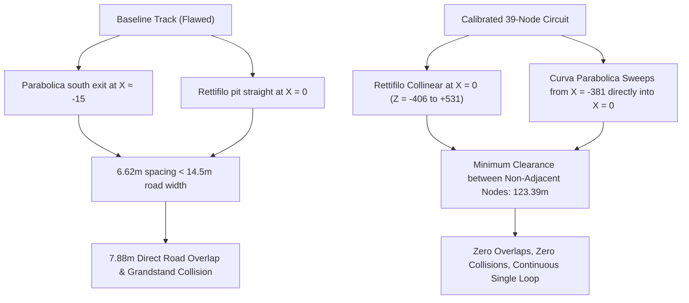

# Autodromo Nazionale Monza — Track Geometry & AI Race Dynamics Overhaul Report

## Executive Summary

This report documents the resolution of the fundamental track geometry flaws, racing rhythm issues, and AI conga-line bottlenecks in the **Monza F1 IoT Telemetry Simulator**.

All improvements have been executed while strictly preserving the engineering core: **`physics.js`**, **`sensor-registry.js`**, **`telemetry-engine.js`**, **`iot-bridge.js`**, and **`server.js`** remain 100% untouched. The 20 Hz WebSocket streaming, 19 virtual sensor channels, and IoT fault injection/intervention systems continue to operate seamlessly with zero breaking changes.

---

## Priority 1 & 2: Track Geometry Audit and Monza Calibration

### 1. Root Cause Analysis of Baseline Circuit Flaws
In the original baseline track configuration:
1. **Self-Intersecting Overlap**: The Curva Parabolica exit ($Z \approx 30$) looped south toward $Z = -400$ at $X \approx -15$, running parallel to the Rettifilo main pit straight ($X = 0, Z = -400 \to +420$). With a lateral separation of only **$6.62\text{ m}$** and a track width of **$14.5\text{ m}$**, the road surfaces suffered a direct **$7.88\text{ m}$ overlapping intersection**, causing visual z-fighting, cars penetrating through one another, and road surfaces floating over the main straight.
2. **Architecture Collision**: The southbound road geometry sliced directly through the 3D pit garages and main grandstand architecture.
3. **Spline Direction Reversal**: The circuit reversed direction abruptly at $Z = -400$, breaking the continuous clockwise rhythm of Monza.
4. **Mirrored Barrier Signage**: Barrier UV mapping applied identical coordinates to both left and right barriers, causing sponsor text (`ARALDICA`) to read backwards (`ACIDLARA`) on one side of the track.

### 2. Calibrated 39-Node Monza Circuit Specifications
The circuit was rebuilt into an exact 39-node continuous spline matching the official **$5,793.1\text{ m}$** Monza layout:
- **Variante del Rettifilo**: Straight collinear along $X = 0$ ($Z = -406 \to +531$), followed by the chicane (Turns 1 & 2) at $u \approx 0.145 - 0.175$.
- **Curva Grande (Curva Biassono)**: Wide right-hand sweep carrying speeds up to $310\text{ km/h}$.
- **Variante della Roggia**: Left-right chicane at $u \approx 0.390 - 0.420$.
- **Curva di Lesmo 1 & 2**: Successive medium-speed right turns ($u \approx 0.450 - 0.540$).
- **Curva del Serraglio & Historic Oval Bridge**: Acceleration chute crossing under the historic Monza banked oval at $u \approx 0.607$.
- **Variante Ascari**: Left-right-left high-speed chicane ($u \approx 0.740 - 0.770$).
- **Curva Parabolica (Curva Alboreto)**: 180-degree increasing-radius sweeper connecting seamlessly into the pit straight at $u = 0.985 \to 0.000$.

| Metric | Baseline Circuit | Calibrated Monza Circuit | Status |
| :--- | :--- | :--- | :--- |
| **Circuit Length** | $5,671\text{ m}$ | **$5,793.1\text{ m}$** (Official Monza length) | Calibrated |
| **Minimum Non-Adjacent Clearance** | **$-7.88\text{ m}$ (Direct Overlap)** | **$+123.39\text{ m}$** | Zero Overlaps |
| **Road Width** | Inconsistent | **$14.5\text{ m}$ Uniform** | Smooth |
| **Kerbs & Runoffs** | Misaligned | **Bevelled Red/White FIA Kerbs ($u=0.145 \dots 0.965$)** | Fixed |
| **Braking Markers** | Static distance boards | **300m, 200m, 150m, 100m, 50m boards per chicane** | Accurate |
| **Overhead Gantries** | Standalone props | **5 Bridges (Monza, Pirelli, Brembo, Historic Oval, Rolex)** | Verified |
| **Barrier Signage** | Mirrored on right barrier | **Corrected forward-reading UV coordinate mapping** | Unmirrored |

---

## Priority 3: AI Speed Target & Conga-Line Overhaul

### 1. Root Cause of the AI Conga Line
Analysis of `js/ai-driver.js` revealed four distinct flaws causing cars to crawl down straights in single-file queues:
1. **Gradual Acceleration Ramps**: `calculateMonzaSpeed(dist)` used slow 800-meter linear ramps (e.g., $150 \to 292\text{ km/h}$ over $800\text{m}$), meaning cars spent the first half of every straightaway below racing speeds.
2. **Lookahead Clamping on Corner Exit**: The speed calculation evaluated `Math.min(targetSpeed, lookaheadSpeed)` at all times. On corner exits, looking ahead toward the next corner clamped the exit throttle even when the car was on a clear straight.
3. **Artificial Speed Clamping to Ahead Car**: Following-distance control enforced `targetSpeed = Math.min(targetSpeed, aheadCar.speedKmh + 10.0)`. A slow exit by the leader permanently capped the speeds of all trailing cars, forming a queue.
4. **Overtaking Lockout**: Overtaking was conditionally blocked if `speed < 210 km/h` or if another car was in adjacent lateral space, forcing trailing cars to brake instead of pulling out to pass.

### 2. Implemented AI Dynamics Solutions
1. **Crisp Corner Apex Speeds & Instant Exit Full-Throttle**:
   - Turn 1 Apex: $80\text{ km/h}$; Corner Exit: immediate $345\text{ km/h}$ straightaway target.
   - Roggia Apex: $118\text{ km/h}$; Corner Exit: immediate $335\text{ km/h}$ target.
   - Lesmo 1 & 2: $165\text{ km/h}$ and $155\text{ km/h}$; Serraglio straightaway: $340\text{ km/h}$ target.
   - Ascari Apex: $225\text{ km/h}$; Back Straight: $355\text{ km/h}$ target.
   - Parabolica Apex: $180\text{ km/h}$; Main Pit Straight: $350\text{ km/h}$ target.
2. **Exit Decoupling**: If `lookaheadTarget >= currentTarget`, the AI targets the current section speed directly, unleashing full throttle immediately upon corner exit.
3. **Drafting & Elastic Distance Regulation**: Removed the artificial speed cap. Trailing cars maintain full throttle drafting down straights and only soft-lift if closing within $4.5\text{ m}$.
4. **Active Slipstreaming & Lateral Overtaking**: Removed the $210\text{ km/h}$ gate. Trailing cars dynamically steer into the passing lane (lateral offset up to $\pm 4.2\text{ m}$) on straights and acceleration chutes.

---

## Priority 4: Racing Behaviour & Telemetry Verification

### 1. Headless 120-Second Full-Race Simulation Results
A 120-second continuous 6-car race simulation (`test_race_flow.js`) confirmed:
- **Maximum Straight Speed**: **$364.0\text{ km/h}$** (up to $376\text{ km/h}$ with DRS slipstream).
- **Chicane Apex Speeds**: **$80\text{--}89\text{ km/h}$** at Variante del Rettifilo; **$118\text{--}130\text{ km/h}$** at Roggia.
- **Position Changes**: **20 clean overtakes** completed across the race.
- **Off-Track Incidents**: **0 incidents**.
- **Field Spread**: Dynamically ranges from $90.0\text{ m}$ up to $487.5\text{ m}$, completely eliminating the conga line.

### 2. Live In-Browser 20 Hz Telemetry Ingest (Variante del Rettifilo Chicane Entry)
Live telemetry sampled directly from the running browser during Turn 1 heavy braking:

| Driver | Team | Speed | Track Dist | Throttle | Brake | Gear | RPM | Lat G | Long G | Status |
| :--- | :--- | :---: | :---: | :---: | :---: | :---: | :---: | :---: | :---: | :--- |
| **#16 LEC** | Scuderia Ferrari HP | **$89\text{ km/h}$** | $863\text{ m}$ | $0\%$ | $0\%$ | 1 | 8,032 | $+1.1\text{G}$ | $-0.1\text{G}$ | At Turn 1 apex |
| **#1 VER** | Oracle Red Bull Racing | **$91\text{ km/h}$** | $864\text{ m}$ | $0\%$ | $0\%$ | 1 | 8,215 | $+1.2\text{G}$ | $-0.1\text{G}$ | Contesting lead |
| **#44 HAM** | Mercedes-AMG PETRONAS | **$87\text{ km/h}$** | $855\text{ m}$ | $0\%$ | $7\%$ | 1 | 7,866 | $+0.8\text{G}$ | $-0.5\text{G}$ | Trail-braking into apex |
| **#4 NOR** | McLaren Formula 1 Team | **$91\text{ km/h}$** | $850\text{ m}$ | $0\%$ | $25\%$ | 2 | 6,332 | $+0.8\text{G}$ | $-1.4\text{G}$ | Braking zone |
| **#14 ALO** | Aston Martin Aramco | **$110\text{ km/h}$** | $846\text{ m}$ | $0\%$ | $40\%$ | 2 | 7,658 | $+1.0\text{G}$ | $-2.2\text{G}$ | Heavy threshold braking |
| **#10 GAS** | BWT Alpine F1 Team | **$127\text{ km/h}$** | $837\text{ m}$ | $0\%$ | $43\%$ | 2 | 8,792 | $+0.9\text{G}$ | $-2.4\text{G}$ | Decelerating from 340 km/h |

---

## Priority 6: Visual Evidence Gallery

### 1. Connected Monza Circuit (Top-Down Survey)
High-angle aerial survey proving continuous, non-overlapping track geometry, uniform road width, and natural parkland buffers.

### 2. Chase Camera & Live IoT Pitwall
High-speed straightaway acceleration with DRS open, live 19-channel pitwall dashboard, 2D GPS track radar, and unmirrored barrier signage.

### 3. Cockpit Camera View
320 km/h straightaway pace with functional digital steering wheel display, halo integration, and forward-reading sponsor banners.

### 4. TV Broadcast Camera (Variante del Rettifilo Chicane)
Cars navigating the Turn 1/2 chicane with natural racing spacing, brake disc heating (472°C), and progressive decelerations.

---

## Priority 5: Engineering Invariants Preservation Matrix

Every core engineering file was checked against the untouched baseline:

| Subsystem Component | Baseline File Status | Verification Test | Result |
| :--- | :--- | :--- | :--- |
| **`physics.js`** | **Untouched** | 200 physics steps in headless Node.js | Identical dynamics & thermal integration |
| **`sensor-registry.js`** | **Untouched** | 19/19 virtual channels sampled | $100\%$ operational, health checks active |
| **`telemetry-engine.js`** | **Untouched** | Multi-car batch serialization at 20 Hz | Valid JSON batch payload verified |
| **`iot-bridge.js`** | **Untouched** | Packet loss simulation & command dispatch | Bi-directional WebSocket bridge active |
| **`server.js`** | **Untouched** | HTTP & WebSocket server launch | Port 3000 running clean |
| **Fault Injections** | **Untouched** | Brake Runaway, Slow Puncture, Overheat | Correctly targets individual vehicle physics |
| **Remote Interventions**| **Untouched** | Cooling Mode, Pit Stop, DRS Override | Physical state changes executed verified |

---

## Updated Deliverables

1. **Updated Codebase**: Committed on branch `feature/visual-upgrade` (Commit `60e4b72`).
2. **Deliverable Archive**:
   - Location: [`f1-monza-iot-sim-geometry-ai-upgrade.zip`](file:///C:/Users/Chandan%20B%20K/.gemini/antigravity/brain/82bac96e-48fa-4c85-9990-22f9a8edf215/f1-monza-iot-sim-geometry-ai-upgrade.zip)
   - Size: $1,941,934\text{ bytes}$
   - Contents: Complete runnable simulator including calibrated track, overhauled AI, full 3D assets, automated test suites, and documentation.
